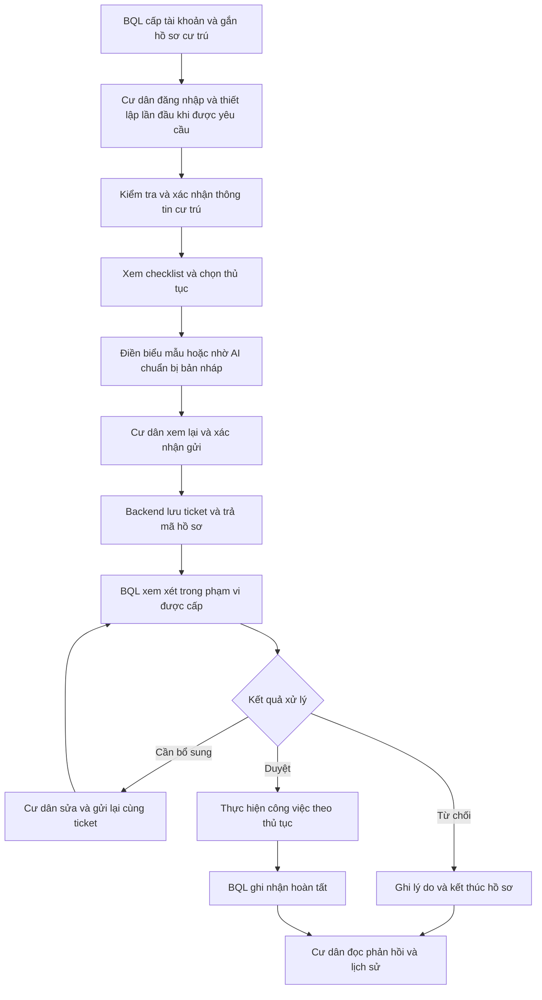
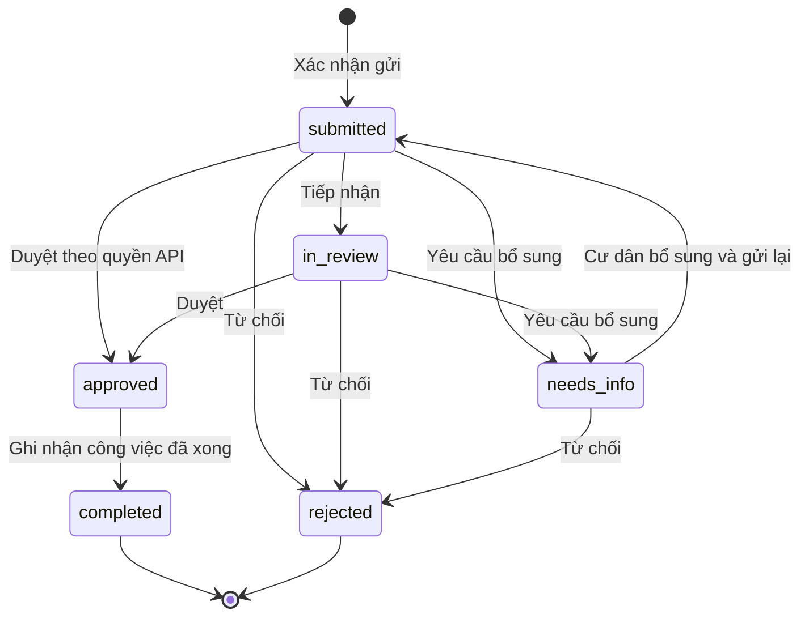
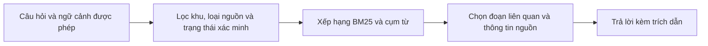
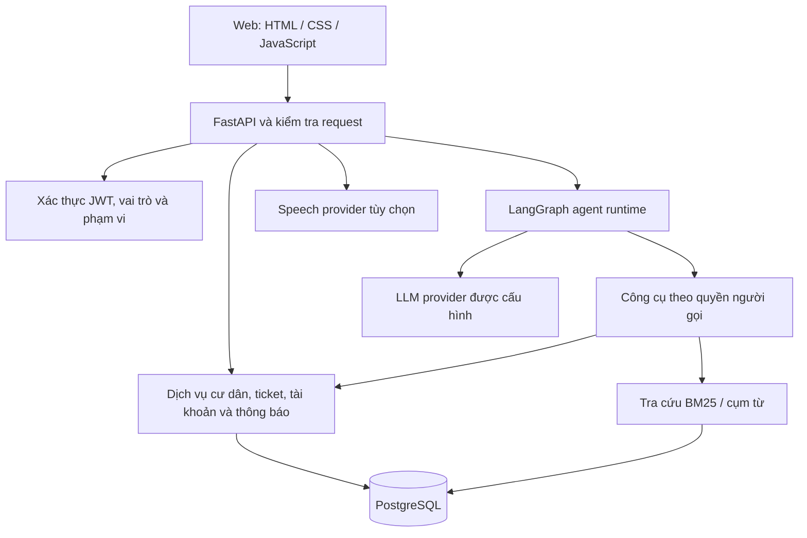

# MoveInMate AI

<div align="center">


**Trợ lý AI đồng hành cùng cư dân mới — từ xác nhận cư trú đến theo dõi kết quả thủ tục.**

[Tổng quan](#tong-quan) · [Nghiệp vụ](#nghiep-vu) · [Luồng xử lý](#luong-xu-ly) · [AI & RAG](#ai-va-rag) · [Kiến trúc](#kien-truc) · [Demo](#demo-va-tai-lieu) · [Cài đặt](#run-with-docker)

</div>

MoveInMate AI kết nối **cư dân và Ban quản lý (BQL)** trong một quy trình thống nhất: xác nhận thông tin cư trú, xác định việc cần làm, chuẩn bị hồ sơ, gửi yêu cầu và theo dõi phản hồi. Cư dân có thể dùng biểu mẫu hoặc trao đổi với trợ lý AI; mọi thay đổi nghiệp vụ được kiểm tra và ghi nhận tại backend.

**Luồng cốt lõi:** hồ sơ/căn hộ → checklist → bản nháp → cư dân xác nhận gửi → ticket → BQL xử lý → kết quả và lịch sử.

**Hiện trạng:** MVP đã có mã ứng dụng, giao diện, migration PostgreSQL và bộ kiểm thử. Đây là bản source để tự triển khai; các tài liệu thiết kế và video là snapshot theo ngày. Kết quả kiểm thử kỹ thuật không thay thế nghiệm thu vận hành tại một khu dân cư thực tế.

<a id="tong-quan"></a>

## 1. Bài toán và giá trị sản phẩm

Khi chuyển vào căn hộ, cư dân cần xử lý nhiều việc liên quan nhau: xác nhận cư trú, thẻ cư dân, người cùng ở, phương tiện, lịch chuyển đồ và dịch vụ. Thông tin phân tán khiến người dùng khó biết cần chuẩn bị gì, đã gửi đến đâu và đang chờ ai xử lý. BQL cần tiếp nhận đúng hồ sơ, đúng phạm vi quản lý và phản hồi có thể truy vết.

| Nhu cầu | Cách MoveInMate hỗ trợ | Kết quả người dùng theo dõi được |
| --- | --- | --- |
| Biết việc nào áp dụng cho mình | Hồ sơ cư trú và checklist theo tình huống | Việc cần làm, trạng thái và bước tiếp theo |
| Chuẩn bị hồ sơ rõ ràng | Biểu mẫu, bản nháp hội thoại, đọc tệp theo cấu hình | Dữ liệu được xem lại trước khi xác nhận |
| Hiểu hướng dẫn và nội quy | Tra cứu có nguồn, có phạm vi khu | Căn cứ tham khảo gắn với câu trả lời |
| Không mất dấu hồ sơ đã gửi | Ticket, phản hồi và lịch sử trạng thái | Mã hồ sơ, yêu cầu bổ sung và kết quả |
| Giảm thao tác tổng hợp cho BQL | Hàng đợi, bộ lọc và trợ lý tóm tắt | Nhóm hồ sơ cần xem xét trong phạm vi được cấp |

Bài toán được hình thành từ phân tích đề tài và nghiên cứu thứ cấp. Repo không công bố số liệu giảm thời gian xử lý, tỷ lệ hài lòng hay độ chính xác AI đã được đo trên người dùng thực tế.

<a id="nghiep-vu"></a>

## 2. Vai trò, phạm vi và quyền quyết định

Hệ thống có hai vai trò người dùng chính: **cư dân (`resident`)** và **BQL (`manager`)**. Chủ sở hữu, người nhà và người thuê là các tư cách cư trú trong nhóm cư dân. Agent sử dụng quyền của người đang thao tác.

| Khả năng | Chủ sở hữu | Người nhà / người thuê | BQL |
| --- | --- | --- | --- |
| Xem và xác nhận thông tin cư trú được cấp | Hồ sơ của mình | Hồ sơ của mình | Cấp/đối chiếu dữ liệu theo phạm vi |
| Xem người và xe cùng căn hộ đã xác nhận | Trong căn hộ được phép | Trong căn hộ được phép | Theo quyền quản lý |
| Khai báo thêm người cư trú | Gửi yêu cầu | Không có quyền này | Kiểm tra và xử lý hồ sơ |
| Đăng ký tài khoản cư dân phụ thuộc | Cho người đủ điều kiện cùng căn | Không có quyền này | Xem lại, duyệt và cấp |
| Đăng ký phương tiện, gửi thủ tục | Theo điều kiện của từng thủ tục | Theo điều kiện của từng thủ tục | Kiểm tra và phản hồi |
| Bổ sung / hủy ticket | Ticket của mình, khi trạng thái cho phép | Ticket của mình, khi trạng thái cho phép | Xử lý theo quyền và trạng thái |
| Duyệt / từ chối / yêu cầu bổ sung | Không | Không | BQL có thẩm quyền |
| Ghi nhận hoàn tất công việc | Không tự quyết định kết quả BQL | Không tự quyết định kết quả BQL | Sau khi đáp ứng điều kiện nghiệp vụ |
| Ẩn mục đã kết thúc khỏi danh sách | Danh sách của mình | Danh sách của mình | Danh sách BQL của mình |

BQL cấp tài khoản cư dân và gắn với người, khu, tòa, căn hộ. Ứng dụng không cung cấp chức năng tự đăng ký tài khoản BQL. Backend kiểm tra phiên đăng nhập, vai trò, phạm vi khu/căn hộ, quyền trên tài nguyên và trạng thái hồ sơ trước khi xử lý.

### Các nhóm nghiệp vụ

| Nhóm | Phạm vi hỗ trợ trong MVP |
| --- | --- |
| Cư trú và căn hộ | Xác nhận dữ liệu BQL cấp; xem người cùng ở; chủ sở hữu gửi yêu cầu thêm người |
| Tài khoản cư dân | Cấp trực tiếp bởi BQL; đăng ký tài khoản phụ thuộc; thiết lập lần đầu; đổi/cấp lại mật khẩu |
| Checklist chuyển vào | Theo dõi tiến độ; một số mục được xác nhận chưa có nhu cầu mà không tạo ticket |
| Thẻ cư dân | Chuẩn bị yêu cầu cấp/cấp lại, gửi hồ sơ, theo dõi quyết định và kết quả |
| Phương tiện | Khai báo xe, đính kèm giấy tờ theo yêu cầu, xem trạng thái xử lý |
| Thủ tục và dịch vụ | Khai báo tạm trú, chuyển đồ, khách, internet và yêu cầu hỗ trợ theo biểu mẫu hiện có |
| Ticket và thông báo | Tiếp nhận, bổ sung, duyệt/từ chối, hoàn tất; đọc phản hồi và lịch sử |
| Nội quy và tri thức | Tra cứu nguồn, đọc nội quy và xác nhận theo phiên bản được cung cấp |

Việc đăng ký trong ứng dụng ghi nhận hồ sơ và quá trình xử lý. Phát thẻ vật lý, mở cổng, xác thực giấy tờ với cơ quan bên ngoài hoặc kích hoạt dịch vụ nhà mạng cần quy trình/tích hợp riêng.

<a id="luong-xu-ly"></a>

## 3. Hành trình cư dân và BQL

### 3.1. Từ tài khoản đến kết quả thủ tục



Đây là hành trình nghiệp vụ chính. Điều kiện hủy, sửa và chuyển trạng thái được kiểm tra riêng cho từng loại hồ sơ và thao tác.

### 3.2. Cấp tài khoản cho người nhà / người thuê

1. Chủ sở hữu chọn người đã được duyệt cư trú, cùng căn hộ và đủ điều kiện nhận tài khoản.
2. Chủ sở hữu xem lại và gửi yêu cầu đăng ký tài khoản phụ thuộc.
3. BQL đối chiếu hồ sơ, xem thông tin cấp tài khoản và xác nhận quyết định.
4. Backend tạo tài khoản, liên kết đúng người/ticket và ghi lịch sử trong giao dịch.
5. Người có quyền nhận thông tin bàn giao qua luồng riêng; cư dân mới thiết lập tên đăng nhập và mật khẩu cá nhân.

Gửi lại thao tác cấp cho cùng ticket không tạo thêm tài khoản. Sau khi cư dân đổi mật khẩu, bản bàn giao cũ không còn được cung cấp; mật khẩu cá nhân không thể được xem lại từ hash.

### 3.3. Bổ sung hồ sơ và đọc kết quả

Cư dân bổ sung trên **ticket hiện có**, dựa trên yêu cầu của BQL. Hệ thống giữ mã hồ sơ, lưu thay đổi và đưa hồ sơ gửi lại về trạng thái chờ xử lý. Thông báo được nhóm theo ticket để cư dân đọc lý do, kết quả và các mốc liên quan.

Thao tác ẩn ticket/thông báo đã kết thúc chỉ tác động đến danh sách của tài khoản tương ứng. Thao tác này không xóa dữ liệu nghiệp vụ và không thay đổi danh sách của người khác.

## 4. Vòng đời ticket và quy tắc nghiệp vụ

| Trạng thái | Ý nghĩa | Điểm kiểm soát |
| --- | --- | --- |
| `submitted` — Đã gửi | Backend đã lưu hồ sơ | Chưa đồng nghĩa BQL đã tiếp nhận |
| `in_review` — Đang xem xét | BQL đang xử lý | Cần quyết định hoặc phản hồi tiếp theo |
| `needs_info` — Cần bổ sung | Chờ cư dân cung cấp/sửa dữ liệu | Gửi lại giữ nguyên mã ticket |
| `approved` — Đã duyệt | BQL đã chấp thuận | Chưa tự động đồng nghĩa công việc thực tế hoàn thành |
| `completed` — Hoàn tất | Đã ghi nhận kết quả theo điều kiện nghiệp vụ | Trạng thái kết thúc |
| `rejected` — Từ chối | Hồ sơ bị từ chối, có lý do | Trạng thái kết thúc |
| `cancelled_by_resident` — Đã hủy | Cư dân hủy theo điều kiện cho phép | Trạng thái kết thúc |



Sơ đồ thể hiện nhánh xét duyệt thông thường; nhánh hủy của cư dân áp dụng theo điều kiện riêng. Luồng cấp tài khoản phụ thuộc có giao dịch chuyên biệt. UI hướng dẫn tiếp nhận trước khi duyệt, trong khi state machine hiện cho phép BQL đúng quyền quyết định trực tiếp từ `submitted` qua API. [Quy tắc trạng thái trong source](src/repositories/store.py) là căn cứ thực thi.

Những nguyên tắc xuyên suốt:

- **Nháp và hồ sơ đã gửi:** chỉ thông báo đã gửi khi backend lưu thành công và trả kết quả nghiệp vụ.
- **Duyệt và hoàn tất:** chỉ ghi nhận hoàn tất theo điều kiện thực tế của thủ tục.
- **Xác nhận có phạm vi:** thao tác dựa trên người thực hiện, dữ liệu và trạng thái được xem lại; dữ liệu quan trọng thay đổi thì cần kiểm tra lại.
- **Gửi lặp và cấp lặp:** dùng idempotency, kiểm tra phiên bản và giao dịch để tránh ghi trùng.
- **Giới hạn quyền:** cùng căn hộ hoặc có tên trong danh mục khu không tự tạo quyền quản lý.

<a id="ai-va-rag"></a>

## 5. AI hỗ trợ theo ngữ cảnh và quyền người dùng

### 5.1. Trợ lý cư dân

Trợ lý giải thích checklist, tra cứu nội quy, hỏi rõ thông tin còn thiếu và chuẩn bị bản nháp thủ tục. Khi người dùng chủ động đính kèm tệp, chức năng đọc tệp có thể hỗ trợ trích thông tin theo định dạng, giới hạn API và khả năng của provider được cấu hình. Cư dân kiểm tra dữ kiện trước khi sử dụng và xác nhận trước khi gửi.

Khi BQL yêu cầu bổ sung, trợ lý đọc phản hồi của đúng ticket, giải thích phần cần sửa và hỗ trợ chuẩn bị nội dung gửi lại. Backend giữ quyền kiểm tra dữ liệu, điều kiện gửi và trạng thái chính thức.

### 5.2. Trợ lý BQL

Trợ lý hỗ trợ tìm kiếm, lọc, nhóm và tóm tắt hồ sơ trong phạm vi quản lý. Các đề xuất thao tác hội thoại được giới hạn ở **tiếp nhận, hoàn tất hoặc ẩn mục đã kết thúc**, tối đa **20 ticket mỗi lần**, có bước xem lại và xác nhận của BQL.

Duyệt, từ chối và yêu cầu bổ sung là quyết định của BQL qua luồng được phân quyền. Nội dung ticket, tệp đính kèm hoặc lời trả lời của model không thay thế xác nhận của người có thẩm quyền.

### 5.3. Tra cứu có nguồn — RAG



Phiên bản hiện tại dùng dữ liệu tri thức trong PostgreSQL và xếp hạng BM25/cụm từ. Nguồn văn bản công khai, nội quy theo khu và nội dung demo cần được phân biệt. Một văn bản tham khảo không tự trở thành nội quy đã được BQL phê duyệt.

Khi thiếu căn cứ phù hợp hoặc gặp lỗi provider, ứng dụng cần thể hiện giới hạn thay vì coi tác vụ đã hoàn thành. Kết quả đọc ảnh hỗ trợ nhập liệu, không xác minh tính thật/giả của giấy tờ.

**Hội thoại và giọng nói:** giao diện cư dân có tích hợp nhận dạng/tổng hợp giọng nói theo cấu hình; key, endpoint và khả năng hỗ trợ phụ thuộc nhà cung cấp. Repo public không kèm dịch vụ AI hoặc speech đang vận hành.

## 6. Không gian làm việc và trải nghiệm

| Khu vực | Nội dung chính |
| --- | --- |
| Đăng nhập và thiết lập | Phiên đăng nhập, thiết lập lần đầu, đổi mật khẩu và yêu cầu hỗ trợ khôi phục |
| Việc cần làm khi chuyển vào | Checklist, trạng thái hiện tại và mở thủ tục tương ứng |
| Thủ tục và trợ lý | Biểu mẫu, chat, bản nháp, dữ liệu cần xem lại và xác nhận |
| Quản lý căn hộ | Người cùng ở, phương tiện và thông tin căn hộ trong phạm vi được phép |
| Ticket đã gửi | Tìm/lọc, đọc nội dung, bổ sung hoặc hủy khi được phép |
| Thông báo BQL | Phản hồi nhóm theo hồ sơ, trạng thái đọc và kết quả xử lý |
| Không gian BQL | Hàng đợi, tài khoản cư dân, xử lý hồ sơ và trợ lý tổng hợp |

Giao diện sử dụng thẻ thủ tục, biểu mẫu theo ngữ cảnh, bước xem lại và lịch sử để giúp người dùng hiểu đang làm gì và đang chờ ai. Các hành động nhạy cảm cần xác nhận rõ; kết quả hiển thị dựa trên phản hồi backend. Có bố cục responsive, chế độ sáng/tối và hỗ trợ giảm chuyển động.

<a id="kien-truc"></a>

## 7. Kiến trúc và công nghệ đang sử dụng



| Lớp | Thành phần | Trách nhiệm |
| --- | --- | --- |
| Giao diện | HTML, CSS, JavaScript | Workspace cư dân/BQL, biểu mẫu, chat và tiến độ |
| Web/API | FastAPI, Pydantic | Route, schema, xử lý request và phục vụ asset |
| Agent | LangGraph, LangChain integrations | Hội thoại, gọi công cụ, giữ ngữ cảnh và giới hạn thực thi |
| Nghiệp vụ | Python services và repositories | Phân quyền, quy tắc trạng thái, giao dịch và kết quả xử lý |
| Dữ liệu | PostgreSQL, SQLAlchemy, Alembic | Lưu hồ sơ, ticket, tài khoản, lịch sử và migration |
| Tri thức | BM25 / phrase retrieval | Lọc và xếp hạng nguồn theo ngữ cảnh |
| Bảo mật | Local JWT, scoped authorization, mã hóa cấu hình | Phiên, quyền dữ liệu và bí mật vận hành |
| Đóng gói | Docker, Docker Compose; template AWS/Nginx | Tự triển khai ứng dụng và database |

Tài liệu đề bài có thể nhắc đến Next.js, Supabase hoặc Chroma như cấu hình thiết kế ban đầu. Bản source hiện hành sử dụng frontend tĩnh, xác thực local JWT và retrieval BM25/cụm từ trên PostgreSQL. Xem [kiến trúc](docs/architecture.md) và [cấu hình mẫu](.env.example).

## 8. Chất lượng, bảo mật và phạm vi kiểm chứng

| Hạng mục | Bằng chứng và phạm vi |
| --- | --- |
| Kiểm thử Python | **1.201 test đạt**, chạy trên PostgreSQL tạm riêng trong đợt kiểm tra bản public ngày **09/11/2026** |
| Kiểm thử JavaScript | **245 test đạt** trong cùng đợt kiểm tra |
| Chất lượng mã | Ruff đạt; kiểm tra chức năng ứng dụng, phân quyền, trạng thái và dịch vụ qua bộ test hiện có |
| Khởi động | Smoke test: trang chủ HTTP 200; health báo cần cấu hình khi chưa có LLM credentials |
| Rà soát bản public | Gitleaks và đối chiếu giá trị bí mật; không đưa `.env`, database, backup hoặc lịch sử Git gốc lên repo |
| Bằng chứng nghiệp vụ | Video demo, tài liệu yêu cầu/thiết kế và kiểm thử dùng dữ liệu giả lập |

Các con số trên là kết quả của một snapshot và môi trường cụ thể; không phải cam kết CI luôn xanh, độ chính xác của model hay SLA production. [Ghi chú kiểm chứng](docs/PUBLIC_RELEASE.md) nêu điều kiện và giới hạn; Docker image production chưa được build trong đợt kiểm tra đó.

Môi trường tự triển khai cần khóa và mật khẩu riêng, database test tách biệt, quản lý khóa mã hóa và quy trình backup/restore. Việc gửi nội dung tới LLM/speech provider cần được cân nhắc theo dữ liệu và cấu hình sử dụng. Chính sách và kênh báo lỗi nằm trong [SECURITY.md](SECURITY.md).

Phạm vi cần tiếp tục xác nhận khi đưa vào vận hành: nội quy được BQL phê duyệt, chính sách lưu/xóa giấy tờ, chất lượng trả lời trên bộ câu hỏi thực tế, tích hợp hệ thống tòa nhà và tiêu chí nghiệm thu của đơn vị sử dụng. Các mục UI ghi **Coming soon** chưa được coi là quy trình hoàn thiện.

<a id="demo-va-tai-lieu"></a>

## 9. Demo và hồ sơ dự án

| Tài liệu | Mục đích |
| --- | --- |
| [Video demo cư trú, cấp tài khoản và thẻ cư dân](project-docs/DEMO/demo-3phut-20261017/MoveInMate-demo-cu-tru-cap-tai-khoan-va-the-cu-dan-20261018-1.5x.mp4) | Xem hành trình nghiệp vụ được ghi hình; có thể tải MP4 về nếu GitHub không hiện trình phát |
| [Slide trình bày](project-docs/PRESENTATION/T047-G03-20261017/MoveInMate-T047-G03.pdf) | Tổng quan bài toán, sản phẩm và luồng xử lý |
| [Hướng dẫn trải nghiệm và dữ liệu test](project-docs/INVESTOR_DEMO_GUIDE_AND_TEST_DATA.md) | Kịch bản kiểm tra và những điểm cần đối chiếu |
| [Đăng nhập và cấp tài khoản](project-docs/AUTH_SETUP.md) | Luồng xác thực, bàn giao và hỗ trợ mật khẩu |
| [Project Brief](project-docs/PROJECT_BRIEF.md) · [BRD](project-docs/MoveInMate_BRD.md) · [PRD](project-docs/MoveInMate_PRD.md) | Bài toán, yêu cầu và tiêu chí thiết kế ban đầu |
| [SAD](project-docs/MoveInMate_SAD_v1.0.md) · [Kiến trúc hiện hành](docs/architecture.md) | Thiết kế gốc và cấu trúc bản source public |
| [Mục lục project-docs](project-docs/README.md) | Truy cập hồ sơ thiết kế, slide và demo |

Tài liệu/video giữ ngày và phạm vi lịch sử của từng bản. Dữ liệu demo được mô phỏng; tên khu trong danh mục không chứng minh đơn vị đó đã hợp tác hoặc phê duyệt MoveInMate. Repo public đã bỏ ảnh đề bài `de_tai.png`, thay địa chỉ triển khai cũ bằng địa chỉ mẫu trong tài liệu liên quan và che mã học viên trong PDF, đồng thời giữ tên tác giả và giấy phép.

<a id="huong-dan-ky-thuat"></a>

## 10. Cài đặt, phát triển và giấy phép

Phần kỹ thuật dưới đây được giữ nguyên từ README trước: cách chạy Docker, cấu hình biến môi trường, phát triển trên host, cấu trúc thư mục, lệnh kiểm thử và giấy phép. Để bắt đầu, xem [Run with Docker](#run-with-docker).

---

A resident onboarding assistant with checklists, resident profiles, management requests, ticket history and role-scoped AI tools. FastAPI serves the API and HTML/CSS/JavaScript frontend; PostgreSQL stores application data; LangGraph orchestrates the assistant.

This repository is a source release for self-hosting. It does not include operational accounts, resident records, API keys, databases or access to the original deployment.

## Features

- Local login, resident/management roles, first-login setup and password recovery.
- Household profiles, onboarding checklists, resident-card and vehicle workflows.
- Management tickets, notifications, decisions and status history.
- LangGraph tools scoped to the authenticated user.
- BM25/phrase retrieval with source and residential-site filtering.
- Optional LLM, speech-to-text and text-to-speech integrations.

## Run with Docker

Install Docker and Docker Compose v2. On Windows, use Docker Desktop with Linux containers. Python 3.11+ can generate the configuration secrets below.

```powershell
git clone https://github.com/congminh1705/MoveInMate-AI.git
Set-Location MoveInMate-AI
Copy-Item .env.example .env
```

Edit `.env` before starting:

| Variable | Configuration |
|---|---|
| `POSTGRES_DB` | `moveinmate_dev` for a new development database |
| `POSTGRES_TEST_DB` | `moveinmate_test`; must differ from the application DB |
| `POSTGRES_PASSWORD` | A new database password |
| `DATABASE_URL` | Host Python URL with matching user/password/DB and `localhost` host |
| `TEST_DATABASE_URL` | Separate test database URL |
| `AUTH_JWT_SECRET` | A new random secret of at least 32 characters |
| `SETTINGS_ENCRYPTION_KEY` | A new Fernet key, backed up separately from the database |
| `LOCAL_AUTH_ADMIN_PASSWORD` | Your own management account password |
| `LOCAL_AUTH_USER_PASSWORD` | Your own configured resident account password |

Generate a fresh URL-safe password/JWT secret for each purpose:

```powershell
python -c "import secrets; print(secrets.token_urlsafe(48))"
```

Generate a Fernet key using only the Python standard library:

```powershell
python -c "import base64,secrets; print(base64.urlsafe_b64encode(secrets.token_bytes(32)).decode())"
```

Use URL-safe database credentials to avoid URL escaping issues. Compose sets the database host to `db` inside the backend container. Keep `AUTH_MODE=required`, `ALLOW_DEMO_AUTH=false`, `SHOW_LOCAL_LOGIN_CREDENTIALS=false` and `LOGIN_RESET_ENABLED=false`. Tracing is disabled by default. Configure your own LLM provider/API key for AI features; speech providers need their own configuration.

```powershell
docker compose config --quiet
docker compose build backend
docker compose up -d --wait db
docker compose run --rm --no-deps backend python -m scripts.migrate_database
```

Only for a new, disposable demo database, optionally seed synthetic records:

```powershell
docker compose run --rm --no-deps backend python -m scripts.seed_demo
```

Then start the application:

```powershell
docker compose up -d --wait --wait-timeout 180 backend
Invoke-RestMethod http://localhost:8000/api/v1/health
```

Open **http://localhost:8000** and sign in with the `LOCAL_AUTH_*` credentials you configured. API documentation is at **http://localhost:8000/docs**. There is no operational password distributed with this repository.

Public source URLs are listed in `scripts/public_sources.json`. To import them, run `docker compose exec -T backend python scripts/crawl_data.py` and restart the backend. Bundled knowledge examples are demo material, not approved building regulations.

## Develop on the host

Start PostgreSQL and configure host URLs in `.env`, then run:

```powershell
python -m venv .venv
.venv\Scripts\python.exe -m pip install -r requirements.txt
.venv\Scripts\python.exe -m scripts.migrate_database
.venv\Scripts\python.exe -m uvicorn src.main:app --host 127.0.0.1 --port 8000
```

Do not re-seed an existing database with data you need to keep. Back up important databases and verify restoration before migration.

## Structure and validation

- `src/`: API, agent, authorization, services and repositories.
- `web/`: static frontend and assets; no frontend build step.
- `alembic/`: database migrations.
- `scripts/`: migration, backup, catalog import, crawling and demo seeding.
- `tests/`: Python and JavaScript tests.
- `eval/fixtures/`: explicitly synthetic evaluation fixtures.
- `deploy/aws/`: deployment templates to adapt to your own infrastructure.

Python tests require a separate PostgreSQL test database. Tests can delete/recreate test data. Never point `TEST_DATABASE_URL` at an operational database.

```powershell
.venv\Scripts\python.exe -m ruff check src tests alembic scripts/seed_demo.py deploy/aws/*.py
.venv\Scripts\python.exe -m pytest tests/ -q --tb=short
node --test tests/web/*.test.mjs
```

CI is available as a manual workflow in the **Actions** tab. This copy does not install prompt-collection hooks from the original development environment.

See [architecture](docs/architecture.md), [public release notes](docs/PUBLIC_RELEASE.md), [security](SECURITY.md) and [contributing](CONTRIBUTING.md).

Historical design documents, the presentation and demo video are available in [project-docs](project-docs/README.md). Some historical references point to evidence not included in this source release. Use the setup instructions above for this repository.

## License and attribution

The original source is distributed under the [MIT License](LICENSE), copyright 2026 AI20K Build Phase. The copyright notice is retained; this copy does not claim sole authorship for the personal repository owner.

Bundled Open Mascot code retains its author's [MIT license](web/vendor/open-mascot/LICENSE). Publishing source does not transfer the original deployment's accounts, data or infrastructure access.
