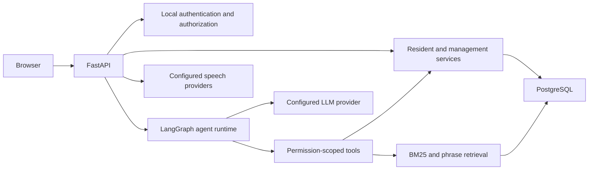

# Architecture

FastAPI serves both the API and static HTML/CSS/JavaScript. `AppContainer` wires PostgreSQL repositories, local authentication, retrieval, agent tools, LLM clients and speech providers.

Users authenticate locally with JWT-backed sessions. Resident and management actions are scoped by site, role and account. Agent calls use the authenticated user's context. Database migrations live in `alembic/`; the migration command does not seed application data.

Retrieval uses BM25/phrase scoring and filters before selecting results. The retained `CHROMA_PERSIST_DIR` setting supports legacy configuration; this version does not require a Chroma index for retrieval.

Provider credentials belong in local environment configuration. Operational settings can be stored encrypted in PostgreSQL. Keep the Fernet encryption key separately from database backups: changing or losing the key can make existing encrypted values unreadable.

Demo fixtures and knowledge documents are synthetic examples, not verified building rules. Deployments should supply their own approved rules and access controls.
