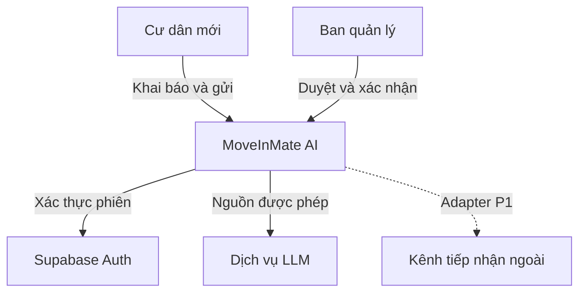
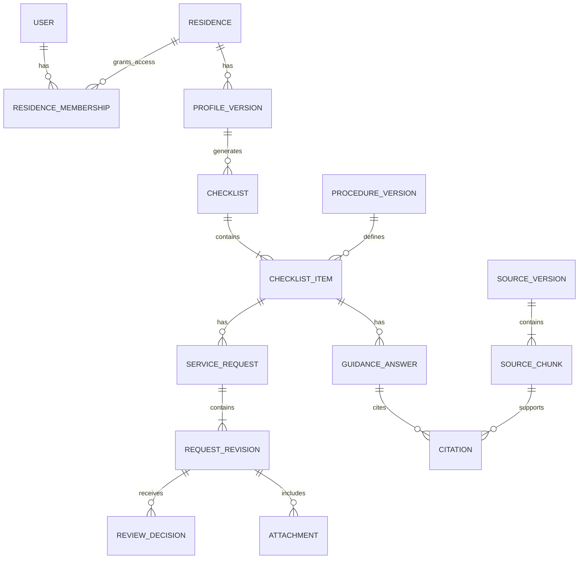
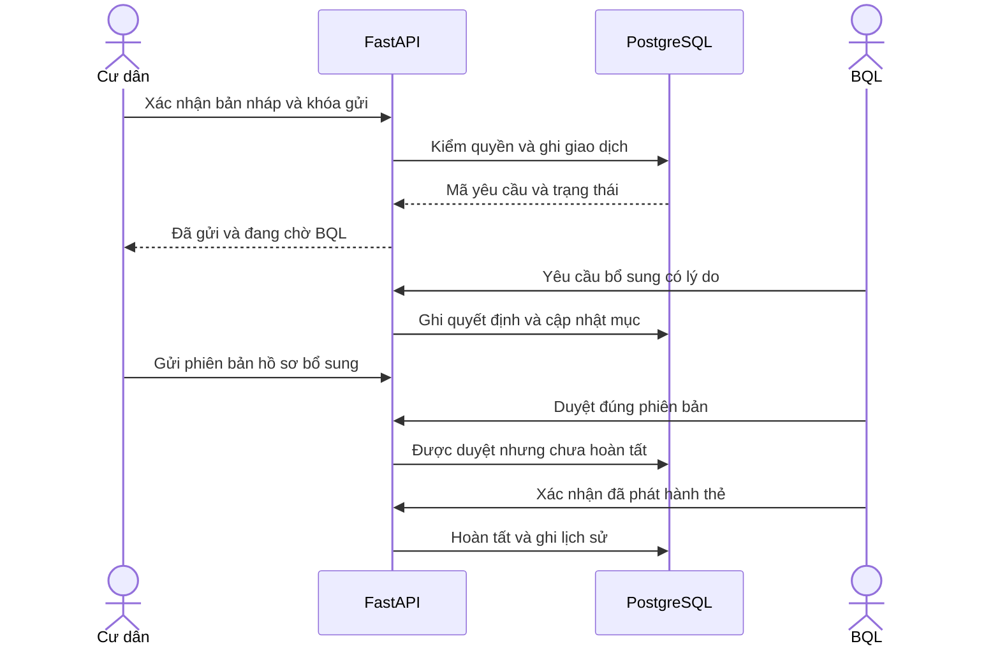
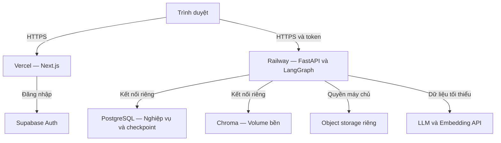

# Tài liệu kiến trúc phần mềm MoveInMate AI

> **SAD thiết kế ban đầu được giữ để truy vết, không phải sơ đồ runtime.**
> Hiện trạng 19/10/2026: HTML/CSS/JS, FastAPI, local auth, PostgreSQL,
> LangGraph và RAG BM25/cụm từ; không dùng Supabase/Next.js/Chroma.
> Xem [kiến trúc hiện hành](../docs/architecture_diagram.md) và
> [mô hình dữ liệu thực tế](../docs/nghiep-vu/05-thiet-ke-du-lieu.md).

## Điều chỉnh triển khai local được xác nhận — 17/10/2026

Người dùng xác nhận bỏ Chroma vì chỉ mục được ghi nhưng không tham gia truy vấn,
và phiên bản phát hành mới nhất 1.5.9 còn hai cảnh báo Critical chưa có bản vá.
Bản local sử dụng PostgreSQL làm nguồn tài liệu và BM25/cụm từ để xếp hạng,
không dùng dịch vụ embedding hoặc vector store. Giữ nguyên lọc quyền, khu,
loại nguồn và trạng thái xác minh; không xóa dữ liệu hoặc thư mục Chroma cũ.
Những mô tả Chroma/vector/embedding bên dưới là thiết kế lịch sử, không phải
kiến trúc chạy sau điều chỉnh này. Đoạn ghi nhận ngày 17/10 không xác nhận
commit đang chạy trên AWS; cần đối chiếu riêng bản triển khai hiện tại.

## Cập nhật phạm vi được người dùng xác nhận — 07/10/2026

Người dùng xác nhận mở rộng phạm vi để AI đọc thông tin giấy tờ trong ảnh do cư dân chủ động đính kèm trong chat. Cập nhật này thay thế các giới hạn OCR/đọc ảnh giấy tờ và cấm chuyển ảnh giấy tờ tới LLM trong tài liệu này, riêng cho luồng chat đính kèm. Backend được chuyển ảnh tới model thị giác đang cấu hình để trích xuất thông tin; không đưa ảnh vào chỉ mục embedding.

AI liệt kê trường đọc được, chỉ rõ phần không đọc được và yêu cầu cư dân kiểm tra trước khi dùng cho hồ sơ. Chữ trong ảnh là dữ liệu, không phải chỉ dẫn. Không suy đoán phần mờ, xác nhận giấy tờ hợp lệ, tự cập nhật hồ sơ hay tự gửi yêu cầu. BQL vẫn quyết định nghiệp vụ. Giữ giới hạn upload, xác thực và phân quyền hiện có; không bổ sung lưu tệp gốc lâu dài. Chính sách checkpoint/lưu/xóa production vẫn cần được chốt.

Luồng đang triển khai và giới hạn: [chat và tệp đính kèm](../docs/nghiep-vu/06-api-va-giao-dien.md#chat-tệp-đính-kèm-và-phạm-vi).

**Software Architecture Document — SAD**

Agent hỗ trợ cư dân mới onboarding vào khu dân cư

## Thông tin tài liệu

| Thông tin | Nội dung |
| --- | --- |
| Mã tài liệu | SAD–VHR16–01 |
| Phiên bản và ngày | 1.0 • 26/09/2026 |
| Nhóm dự án | AI thực chiến |
| Trạng thái | Bản đề xuất kiến trúc để nhóm rà soát và triển khai MVP |
| Cơ sở phạm vi | BRD v0.2 ngày 24/09/2026; đối chiếu PRD v0.1 |
| Người phê duyệt | Chưa chỉ định; cần nhóm và đại diện nghiệp vụ xác nhận |

### Tóm tắt kiến trúc

MoveInMate dùng một backend có các mô đun rõ trách nhiệm. Agent làm rõ lời kể, giải thích việc tiếp theo và kiểm nháp thẻ có căn cứ; bộ quy tắc xác định checklist; PostgreSQL giữ trạng thái chính thức; cư dân xác nhận dữ kiện/gửi và BQL quyết định các bước cần xác minh. MVP phục vụ một khu, tiếng Việt và một luồng đăng ký thẻ cư dân có duyệt từ đầu tới cuối.

Tài liệu này mô tả cách xây hệ thống từ yêu cầu đã có: thành phần, dữ liệu, luồng xử lý, API, phân quyền, triển khai, vận hành và kiểm thử. Các lựa chọn bổ sung được ghi là đề xuất; tài liệu không xác nhận hệ thống đã được xây hoặc đã đạt các chỉ tiêu.

### Lịch sử phiên bản

| Bản | Thay đổi | Trạng thái |
| --- | --- | --- |
| 1.0 | Lập SAD từ 12 tệp được cung cấp; thống nhất phạm vi, trạng thái và các quyết định kiến trúc. | Chờ rà soát |

## Mục lục

- [1. Cơ sở tài liệu và phạm vi](#1-cơ-sở-tài-liệu-và-phạm-vi)
- [2. Mục tiêu và yếu tố chi phối kiến trúc](#2-mục-tiêu-và-yếu-tố-chi-phối-kiến-trúc)
- [3. Bối cảnh và ranh giới hệ thống](#3-bối-cảnh-và-ranh-giới-hệ-thống)
- [4. Kiến trúc logic và thành phần](#4-kiến-trúc-logic-và-thành-phần)
- [5. Mô hình dữ liệu](#5-mô-hình-dữ-liệu)
- [6. Quy tắc checklist và quản lý phiên bản](#6-quy-tắc-checklist-và-quản-lý-phiên-bản)
- [7. Kiến trúc tri thức và RAG](#7-kiến-trúc-tri-thức-và-rag)
- [8. Thiết kế agent và memory](#8-thiết-kế-agent-và-memory)
- [9. Luồng xử lý yêu cầu và HITL](#9-luồng-xử-lý-yêu-cầu-và-hitl)
- [10. Mô hình trạng thái](#10-mô-hình-trạng-thái)
- [11. Hợp đồng API](#11-hợp-đồng-api)
- [12. Bảo mật và quyền riêng tư](#12-bảo-mật-và-quyền-riêng-tư)
- [13. Triển khai và cấu trúc mã nguồn](#13-triển-khai-và-cấu-trúc-mã-nguồn)
- [14. Vận hành và phục hồi](#14-vận-hành-và-phục-hồi)
- [15. Chất lượng và kế hoạch kiểm thử](#15-chất-lượng-và-kế-hoạch-kiểm-thử)
- [16. Ma trận truy vết yêu cầu](#16-ma-trận-truy-vết-yêu-cầu)
- [17. Quyết định kiến trúc và vấn đề còn mở](#17-quyết-định-kiến-trúc-và-vấn-đề-còn-mở)
- [18. Tài liệu tham chiếu và thuật ngữ](#18-tài-liệu-tham-chiếu-và-thuật-ngữ)

### Cách đọc

BQL và người phụ trách sản phẩm đọc mục 1–3, 6, 9–10 và 17. Nhóm phát triển đọc toàn bộ, tập trung mục 4–14. Người kiểm thử dùng mục 15–16 để chuyển yêu cầu thành ca thử.

SAD được tổ chức theo các góc nhìn thường dùng: bối cảnh, logic, dữ liệu, xử lý khi chạy, phát triển và triển khai. Đây là cấu trúc tài liệu kiến trúc cho dự án, không phải tuyên bố chứng nhận tuân thủ một tiêu chuẩn quốc tế cụ thể.

## 1. Cơ sở tài liệu và phạm vi

### 1.1 Căn cứ và thứ tự ưu tiên

Đề VHR-16 là căn cứ về mục tiêu và ràng buộc. BRD v0.2 là cơ sở phạm vi nghiệp vụ cụ thể hơn. PRD v0.1 cung cấp mã FR, BR, NFR và tiêu chí kỹ thuật. Brief, nghiên cứu và wireframe bổ sung bối cảnh. Bảng dưới ghi các điểm đã được yêu cầu cập nhật ngày 29/09/2026; đây vẫn là baseline đề xuất, chưa thay quyết định của nhóm/BQL. [S01–S10]

| Điểm khác nhau hoặc còn thiếu | Cách xử lý trong SAD |
| --- | --- |
| BRD và PRD đã thống nhất lại số luồng và tính năng nâng cao | Một luồng thẻ cư dân có duyệt; routing nhiều bộ phận, nhắc việc, dashboard và giao diện quản trị nguồn để P1. |
| BRD từng dẫn MVP_SCOPE.md nhưng tệp này không được đính kèm | Dùng mục 8 và 13 BRD cùng mục 7 Product Brief làm baseline làm việc; chưa coi phạm vi đã được BQL ký duyệt. |
| Wireframe có thể hiện sáu mục; BRD nêu năm nhóm | Chọn xác nhận cư trú, thẻ cư dân, nội quy, phương tiện, internet. Kích hoạt tiện ích là phương án thay internet, chưa thêm nhóm thứ sáu. |
| Wireframe duyệt là hoàn tất và tạo lại làm mất tiến độ | Thiết kế trạng thái và lưu phiên bản theo BRD/PRD; cần sửa khi phát triển ứng dụng. |
| PRD kỳ vọng URL tệp không thể bị dùng chéo người | Tệp nhạy cảm được tải qua API kiểm quyền mỗi lần; không coi signed URL là cơ chế ràng buộc danh tính. |
| PRD/Brief từng để AI soạn bản nháp ở P1 hoặc mô tả AI tự soạn trong P0 | P0 mẫu tạo nháp thẻ; agent làm rõ, kiểm thiếu/chưa rõ theo nguồn và đề xuất nội dung; backend kiểm bắt buộc, cư dân xác nhận gửi. Soạn thảo nâng cao và nhiều loại yêu cầu ở P1. |

### 1.2 Phạm vi MVP

Trong phạm vi: đăng nhập cư dân/BQL; agent hiểu lời kể, hỏi làm rõ và chờ cư dân xác nhận hồ sơ tối thiểu; checklist theo rules; hướng dẫn/việc tiếp theo có nguồn và trạng thái chính thức; nháp thẻ từ mẫu được agent kiểm/đề xuất nội dung và backend kiểm điều kiện; cư dân xác nhận gửi; BQL bổ sung/duyệt/từ chối/xác nhận hoàn tất; lưu tiến độ, lịch sử và kiểm soát dữ liệu. Kênh nhận là hàng đợi BQL trong ứng dụng, không phụ thuộc hệ thống ngoài.

Ngoài phạm vi: thanh toán, cấp thẻ vật lý bằng phần mềm, OCR, khuôn mặt, ký số, nhiều khu trong sản phẩm, soạn thảo yêu cầu nâng cao, định tuyến nhiều bộ phận, nhắc việc tự động, dashboard vận hành và tích hợp mọi bộ phận. Phần mềm chỉ ghi nhận việc phát thẻ khi người có quyền xác nhận.

### 1.3 Mức độ hiện thực

SAD này là baseline thiết kế ngày 26/09/2026, không phải báo cáo nghiệm thu phiên bản hiện tại. Hiện trạng và bằng chứng được đối chiếu tại [README](../README.md) và [eval sản phẩm](../deliverables/05-eval-evidence.md). Bộ kiểm thử kỹ thuật tối thiểu vẫn phải có trong P0; công cụ eval tự động hoàn chỉnh thuộc P1.

## 2. Mục tiêu và yếu tố chi phối kiến trúc

### 2.1 Mục tiêu thiết kế

Kiến trúc phải giúp cư dân biết việc áp dụng cho mình và tin được nguồn hướng dẫn lẫn trạng thái. Vì vậy, quyền truy cập, điều kiện thủ tục và quyết định duyệt được thực thi bằng dịch vụ nghiệp vụ; model không làm nguồn xác nhận cho những phần này.

| Mối quan tâm | Quyết định thiết kế | Dấu hiệu đạt |
| --- | --- | --- |
| Đúng checklist | Dữ kiện do cư dân xác nhận; rules có phiên bản, điều kiện xác định và lý do | Không bỏ sót mục bắt buộc trên bộ đáp án |
| Giá trị agent | Làm rõ đầu vào, chọn hỗ trợ tiếp theo và kiểm nháp có căn cứ; đo với baseline đơn giản | Có kết quả so sánh trên cùng ca, không suy từ tên framework |
| Đúng khu và nguồn | Lọc nguồn tại backend và kiểm lại trước trả lời | Nguồn sai khu hoặc bị thu hồi không được dùng |
| BQL kiểm soát | API duyệt riêng; không cấp tool duyệt cho agent | Cư dân và agent không đổi được trạng thái duyệt |
| Tiến độ đáng tin | PostgreSQL là nguồn trạng thái; cập nhật trong giao dịch | Đăng nhập lại thấy đúng trạng thái và lịch sử |
| Dễ làm và vận hành | Một backend dạng modular monolith | Triển khai ít dịch vụ, mô đun vẫn tách trách nhiệm |
| Chi phí có kiểm soát | Checklist không cần LLM; giới hạn bước và token | Có số liệu latency, token và chi phí mỗi run |

### 2.2 Bên liên quan

Cư dân cần form ngắn, hướng dẫn có nguồn và hành động tiếp theo. BQL cần hàng đợi đúng phạm vi, phiên bản hồ sơ đang duyệt và lịch sử. Chủ quy trình chịu trách nhiệm quy tắc, tài liệu, điều kiện hoàn tất. Nhóm kỹ thuật chịu trách nhiệm tính nhất quán, phân quyền, vận hành và bằng chứng kiểm thử.

### 2.3 Giả định và ràng buộc

Một khu giả lập được dùng cho demo. Tài liệu thủ tục và hồ sơ đều giả lập hoặc được phép dùng. Chưa có SLA, baseline nghiệp vụ, API hệ thống cư dân hoặc chính sách lưu giấy tờ thật. Thông số hạ tầng, nhà cung cấp storage và model embedding cần được chốt khi triển khai.

Giữ stack đề bài: Next.js, FastAPI, LangGraph, GPT-4o-mini, Chroma, PostgreSQL, Supabase Auth, Vercel và Railway. Tên công nghệ là định hướng thiết kế từ đề tài, không khẳng định phiên bản, giá hoặc khả năng cung cấp cụ thể tại ngày triển khai.

### 2.4 Nguyên tắc quyết định

Ưu tiên an toàn nghiệp vụ hơn câu trả lời trôi chảy: thiếu trường thì hỏi thêm; thiếu nguồn thì chuyển BQL; lỗi model không làm mất dữ liệu; lỗi gửi không được tạo yêu cầu trùng. Mọi thay đổi phạm vi phải quay lại đối chiếu BRD và PRD.

## 3. Bối cảnh và ranh giới hệ thống

MoveInMate quản lý kế hoạch onboarding và yêu cầu nội bộ. Hệ thống bên ngoài gồm dịch vụ xác thực, model và kênh nghiệp vụ tương lai. Thông tin từ trình duyệt, câu hỏi và tài liệu RAG đều phải được kiểm tra trước khi sử dụng.

*Hình 1. Bối cảnh hệ thống và các tác nhân*

### 3.1 Ranh giới trách nhiệm

Trình duyệt hiển thị dữ liệu và nhận thao tác. Backend xác minh phiên, kiểm quyền tới từng căn hộ/tài nguyên, gọi rules/RAG và ghi giao dịch. Supabase Auth xác thực danh tính; bảng quyền trong ứng dụng xác định người đó được làm gì. LLM chỉ nhận trường cần thiết và đoạn tài liệu được phép.

### 3.2 Các điểm tích hợp

| Điểm kết nối | Thông tin trao đổi | Quy tắc |
| --- | --- | --- |
| Auth | Token và định danh người dùng | Kiểm chữ ký, hạn dùng, issuer/audience theo cấu hình |
| LLM và embedding | Câu hỏi đã lọc, đoạn thủ tục, output có schema | Không chuyển tệp định danh thô; giữ khóa ở server |
| BQL nội bộ | Yêu cầu, bổ sung và quyết định | Một hàng đợi là đích nhận chính thức trong MVP |
| Hệ thống ngoài ở P1 | Mã yêu cầu, kết quả xử lý | Qua adapter; phải có đối soát và mapping trạng thái |

## 4. Kiến trúc logic và thành phần

### 4.1 Phân rã thành phần

| Mã và thành phần | Trách nhiệm chính | Kho hoặc kết nối |
| --- | --- | --- |
| C01 Next.js UI | Màn hình cư dân/BQL, form, nguồn, timeline; không quyết định quyền | FastAPI và Supabase Auth |
| C02 Identity và Access | Xác minh phiên; user, membership, vai trò; scope từng tài nguyên | Auth và PostgreSQL |
| C03 Profile và Checklist | Phiên bản hồ sơ; rules engine; phụ thuộc; tính tiến độ | PostgreSQL |
| C04 Knowledge và Guidance | Chuẩn hóa nguồn; retrieval; citation; chặn nguồn không hợp lệ | Chroma, PostgreSQL, kho tài liệu |
| C05 Request và Review | Nháp, xác nhận, gửi, bổ sung, duyệt, hoàn tất, idempotency | PostgreSQL và Attachment service |
| C06 Agent orchestration | Trích xuất/hỏi rõ dữ kiện, chọn hỗ trợ tiếp theo, kiểm nháp có nguồn; checkpoint, budget và phục hồi | LangGraph, LLM adapter, dịch vụ nghiệp vụ |
| C07 File service | Tải lên, cách ly/quét, đọc qua API, vòng đời tệp | Object storage riêng và metadata |
| C08 Audit và Operations | Lịch sử nghiệp vụ, run metadata, job xóa và đối soát | PostgreSQL; metrics/log đã lọc |

### 4.2 Quy tắc phụ thuộc

API gọi application service; application service thực thi quy tắc và gọi repository hoặc adapter. Agent cũng gọi application service qua hợp đồng tool giới hạn. UI và LLM không được ghi trực tiếp vào bảng nghiệp vụ. Mô đun Request là nơi duy nhất chuyển trạng thái yêu cầu; Checklist nhận kết quả qua cùng giao dịch hoặc sự kiện có cơ chế chống lặp.

MVP dùng một tiến trình API cho nghiệp vụ và điều phối tương tác. Worker riêng xử lý việc chậm như nạp nguồn, quét tệp, xóa và đối soát. Worker dùng cùng codebase, có tài khoản và quyền tối thiểu. Chưa cần microservices hoặc message broker riêng.

### 4.3 Lựa chọn lưu trữ

PostgreSQL giữ dữ liệu nghiệp vụ, lịch sử và checkpoint trong các schema tách biệt. Chroma chỉ giữ chỉ mục tài liệu thủ tục để tìm theo ý nghĩa. Object storage giữ tệp gốc và giấy tờ ở các vùng tách biệt. Có thể tái tạo chỉ mục từ nguồn đã quản lý phiên bản; không thể dùng Chroma thay cho cơ sở dữ liệu trạng thái.

## 5. Mô hình dữ liệu

Khóa chính đề xuất là UUID. Bảng nghiệp vụ có tenant_id, site_id và liên kết tới cư trú khi phù hợp. Khóa ngoại và kiểm tra dịch vụ phải ngăn liên kết tài nguyên khác khu. Thời điểm lưu theo UTC; giao diện đổi về múi giờ khu.

*Hình 2. Quan hệ dữ liệu cốt lõi được giản lược*

### 5.1 Dữ liệu nhận diện và tiến độ

| Thực thể | Trường và ràng buộc cốt lõi |
| --- | --- |
| User và ResidenceMembership | auth_subject duy nhất; user_id, residence_id, role, status. Chỉ membership đang hiệu lực cho phép truy cập. |
| ProfileVersion | profile_id, version, residence_id, tư cách, số thành viên, phương tiện, internet, consent_ref, resident_confirmed_at, created_by. Chỉ bản được cư dân xác nhận mới là đầu vào rules; mỗi phiên bản bất biến. |
| ProcedureVersion và RuleSet | procedure_code, version, site_id, điều kiện, bắt buộc, dependency, completion_mode, target_state, schema_version. RuleSet tham chiếu các phiên bản cụ thể. |
| Checklist và ChecklistItem | profile_version_id, ruleset_id, revision, is_current; item có procedure_version_id, reason, status, migrated_from_item_id. Một procedure chỉ xuất hiện một lần trong checklist. |

Mỗi checklist tham chiếu đúng phiên bản đầu vào. Chỉ một checklist hiện hành trên một hồ sơ onboarding. Cơ chế tạo bản mới và kế thừa tiến độ được mô tả ở mục 6.

### 5.2 Dữ liệu yêu cầu nguồn và lịch sử

| Thực thể | Thông tin cần lưu |
| --- | --- |
| ServiceRequest | item_id, request_type, department_id, state, current_revision, row_version, external_ref. Có ràng buộc chỉ một yêu cầu đang hoạt động cho cùng mục và loại. |
| RequestRevision và Submission | payload đã xác nhận, payload_hash, attachment_version_ids, actor, confirmed_at, idempotency_key. Mỗi lần bổ sung tạo revision mới. |
| ReviewDecision | request_id, revision_id, action, reason, reviewer_id, decided_at, expected_row_version. Ghi thêm; không sửa ngược quyết định cũ. |
| Attachment | object_key ngẫu nhiên, owner/scope, request_revision_id, media_type, size, checksum, scan_status, retention_until. Tệp thay thế tạo bản mới. |
| SourceVersion và SourceChunk | site_id, source_id, version, effective_from/to, status, owner, checksum; chunk có heading/page/offset, embedding_model và index_version. |
| GuidanceAnswer và Citation | item_id, question/answer theo chính sách lưu, nguồn và chunk đã dùng, source_version_id, vị trí trích dẫn, model/prompt/index version. |
| AgentRun và AgentCheckpoint | thread_id, chủ sở hữu, node, dữ kiện đề xuất chưa xác nhận và điểm thiếu/mâu thuẫn đã lọc PII, input refs, tool metadata, versions, số bước/LLM call, latency, token/chi phí, trạng thái lỗi. Không lưu toàn văn giấy tờ. |
| AuditEvent và OutboxEvent | actor, action, resource/version, timestamp, correlation_id; outbox có event_id, payload_refs, attempts, next_run_at và processed_at. |
| IdempotencyRecord và DataDeletionJob | Khóa theo actor + operation + key, request hash, resource/result. Job xóa có phạm vi, trạng thái, lần thử và bằng chứng. |

### 5.3 Toàn vẹn và truy vấn

Đề xuất index trên (site_id, state, created_at) cho hàng đợi; (owner_id, residence_id) cho quyền; (request_id, revision) và (source_id, version) là duy nhất. Idempotency key duy nhất theo actor và thao tác. Quyết định và cập nhật item/checklist/audit phải cùng transaction. Cập nhật đồng thời dùng row_version; dữ liệu cũ trả lỗi 409 để người dùng tải lại.

### 5.4 Nguồn dữ liệu chính thức

Trạng thái chính thức nằm trong PostgreSQL. Checkpoint agent là dữ liệu điều phối và có thể cũ hơn trạng thái nghiệp vụ. Khi khôi phục, agent phải đọc lại request và quyền. Xóa dữ liệu phải xử lý cả tệp, câu hỏi, checkpoint, log có liên quan và bản sao lưu theo chính sách được duyệt.

## 6. Quy tắc checklist và quản lý phiên bản

### 6.1 Tạo checklist có thể kiểm chứng

C03 tải ProfileVersion đã hợp lệ và RuleSet đang áp dụng của khu. Rules engine đánh giá điều kiện, chọn mục bắt buộc/tùy chọn, gắn lý do, tạo phụ thuộc và sắp xếp thứ tự. Thiếu trường ảnh hưởng điều kiện thì trả missing_fields; không tạo checklist được gắn nhãn đầy đủ. Bộ quy tắc phải không có vòng phụ thuộc.

| Điều kiện minh họa | Kết quả dự kiến | Căn cứ |
| --- | --- | --- |
| Mọi hồ sơ hợp lệ | Xác nhận cư trú, thẻ cư dân, nội quy | Bộ rules giả lập cần BQL rà soát |
| Có phương tiện | Thêm mục phương tiện; giải thích từ hồ sơ | Không thêm khi vehicle = none |
| Có nhu cầu internet | Thêm internet dạng tùy chọn theo cấu hình | Không tự suy ra từ hội thoại |
| Chủ hộ hoặc người thuê | Dùng schema hồ sơ tương ứng | Giấy tờ cụ thể phải có nguồn |

Đây là ví dụ dữ liệu demo, không phải quy định thật. MVP hỗ trợ đăng ký thẻ từ đầu tới cuối. Xác nhận cư trú có thể được cấp sẵn từ membership đã duyệt trong dữ liệu demo; phương tiện và internet có hướng dẫn và cập nhật kết quả ngoài hệ thống bởi người có quyền, chưa mở thêm luồng ticket tự động.

### 6.2 Cập nhật hồ sơ mà không mất tiến độ

Khi đổi trường ảnh hưởng rules, backend tạo ProfileVersion mới và đánh dấu checklist cần đánh giá lại. Sau khi tính diff, UI cho xem mục thêm, bỏ hoặc đổi điều kiện. Backend tạo Checklist revision mới trong giao dịch, chuyển cờ hiện hành và giữ nguyên bản cũ.

Chỉ kế thừa trạng thái hoàn tất khi procedure_code, điều kiện hoàn tất và bằng chứng vẫn còn hợp lệ. Mục thay đổi giấy tờ hoặc điều kiện phải được đánh giá lại; không sao chép trạng thái máy móc. Yêu cầu đang xử lý giữ liên kết phiên bản gốc, được hiển thị trong lịch sử và tham chiếu sang bản mới khi phù hợp. Không hủy yêu cầu đã gửi chỉ vì checklist thay đổi.

### 6.3 Tính tiến độ và kết thúc

Tiến độ bắt buộc = số mục bắt buộc có trạng thái completed / tổng mục bắt buộc đang áp dụng của checklist hiện hành. Không tính submitted hoặc approved là completed. Mục tùy chọn có mẫu số riêng. Checklist cần đánh giá lại không được chốt hoàn tất. Trường hợp mẫu số bằng 0 phải kiểm tra rules và hiển thị “không có mục bắt buộc”, không tự trả 100% do lỗi dữ liệu.

completion_mode gồm resident_acknowledgement cho nội quy; manager_confirmation cho thẻ/phương tiện; external_evidence cho kết quả dịch vụ được người có quyền ghi nhận. BQL phải chốt mapping trước pilot.

## 7. Kiến trúc tri thức và RAG

### 7.1 Nạp và xuất bản tri thức

Chủ tài liệu cung cấp nguồn được phép sử dụng. Worker kiểm loại tệp, checksum, khu, người sở hữu, ngày hiệu lực và phiên bản; chia đoạn theo mục thủ tục, giữ vị trí trang/đề mục; sinh embedding và ghi index thử. Chỉ sau khi kiểm tra retrieval mới đổi active_index_version. P0 có thể dùng script nạp do nhóm vận hành; giao diện xuất bản nguồn thuộc P1.

Embedding biến nội dung thành vector phục vụ tìm theo ý nghĩa. Chroma giữ vector và metadata, không tự đảm bảo nội dung đúng hay quyền truy cập. Model embedding chưa được chọn trong tài liệu gốc: cần thử với tiếng Việt, khóa tên/phiên bản và số chiều; đổi model phải tạo lại index tương ứng.

### 7.2 Luồng trả hướng dẫn

1. Backend kiểm quyền item, lấy site_id từ tài nguyên đã xác thực; đọc ProfileVersion/Checklist/RequestRevision và trạng thái chính thức mới nhất để xác định thủ tục, việc đang chờ cư dân hay BQL.
2. Chọn các SourceVersion đang xuất bản, còn hiệu lực và được phép dùng.
3. Retrieval lọc metadata theo khu, thủ tục và index; lấy các đoạn phù hợp.
4. Đối chiếu lại ID nguồn với PostgreSQL.
5. Agent chọn hướng hỗ trợ được phép (hỏi rõ, giải thích, kiểm nháp hoặc đề xuất việc tiếp theo); LLM tạo câu trả lời có schema khi cần.
6. Kiểm citation, nguồn, quyền và trạng thái trước khi lưu/trả cho cư dân. Việc tiếp theo chỉ là đề xuất, không ghi trạng thái nghiệp vụ. [T03]

Thông số thử ban đầu do SAD đề xuất: đoạn 400–700 token, overlap 50–100 token, tối đa 5 đoạn nguồn cho một câu trả lời. Đây là điểm bắt đầu để eval, không phải thông số đã tối ưu. Ngưỡng liên quan phải được hiệu chuẩn; không quy đổi điểm vector thành “AI tự tin 95%”.

### 7.3 Hợp đồng đầu ra

| Trường | Ý nghĩa |
| --- | --- |
| answer_status | supported, needs_clarification, no_valid_source hoặc conflict |
| steps và required_documents | Các bước/giấy tờ, mỗi nhận định quan trọng có citation_ids |
| submission_channel và notes | Chỉ điền khi nguồn có căn cứ; không bịa SLA hoặc bộ phận |
| citations | source_id, version, title, site, effective_date, section/page, chunk_id |
| next_action | Bước hợp lệ được đề xuất, lý do, phụ thuộc và actor đang chờ (resident/manager); không phải lệnh đổi trạng thái |

### 7.4 Không có nguồn và thay đổi nguồn

Thiếu, hết hạn, xung đột hoặc sai khu: dừng hướng dẫn nghiệp vụ cụ thể và kiểm nháp dựa vào điều kiện chưa xác minh, nêu lý do, chuyển chủ nguồn/BQL xác nhận; không trình bày nháp như đã đủ để gửi. Nguồn thu hồi bị loại ngay ở bước kiểm PostgreSQL dù index chưa xóa xong. Câu trả lời cũ giữ tham chiếu phiên bản cũ và cảnh báo; không đổi liên kết sang bản mới. Cache khóa theo scope và phiên bản index, bị vô hiệu khi nguồn đổi.

## 8. Thiết kế agent và memory

### 8.1 Phân công node

| Node | Vai trò | Điều kiện chuyển bước |
| --- | --- | --- |
| interpret_profile và clarify | Đề xuất dữ kiện từ lời kể/form, phát hiện thiếu/mâu thuẫn và chọn một câu hỏi cần thiết | Chưa lưu ProfileVersion; dừng nếu cư dân chưa xác nhận |
| resident_confirm_profile | Cư dân xem/sửa dữ kiện, backend kiểm schema và lưu ProfileVersion | Từ chối giá trị thiếu/mâu thuẫn hoặc xác nhận trên bản cũ |
| build_checklist | Gọi C03 theo rules xác định từ ProfileVersion đã xác nhận | Lưu checklist và phiên bản trước khi trả kết quả; agent không thêm mục bắt buộc |
| guide, choose_next_help và retrieve | Đọc hồ sơ/checklist/trạng thái chính thức; gọi C04; diễn giải từ nguồn | Đủ nguồn mới trả hướng dẫn/việc tiếp theo xác định, kèm actor đang chờ |
| create_requests và preflight | Mẫu P0 tạo nháp thẻ; agent so trường/giấy tờ với schema và nguồn, chỉ thiếu/chưa rõ, đề xuất nội dung | Lưu nháp/revision với payload hash; backend vẫn chặn thiếu trường/tệp; soạn nâng cao P1 |
| user_confirm và submit | Dừng cho cư dân xem rồi xác nhận qua API | Kiểm lại quyền, phiên bản và hash trước gửi |
| wait_for_human_review | Lưu checkpoint; chờ sự kiện BQL | Không giữ HTTP request hoặc vòng polling LLM |
| explain_needs_info và track | Đọc lý do BQL trên đúng RequestRevision, trạng thái mới nhất và lịch sử; dẫn về trường/tệp cần sửa | Không tự gửi lại hay sửa quyết định BQL |

### 8.2 Trạng thái agent và memory

Agent state gồm run_id, thread_id, user_id/scope do server gán, profile_version_id hoặc dữ kiện đề xuất chưa xác nhận, missing/conflicting fields, checklist_id, item_id, request_id/revision, node, source_refs, version refs, pending_confirmation, error và budget còn lại. Memory dài hạn là dữ liệu hồ sơ/tiến độ trong PostgreSQL; checkpoint giữ vị trí điều phối; hội thoại chỉ lưu phần cần thiết theo chính sách. Dữ kiện agent trích xuất không thành hồ sơ chính thức trước thao tác xác nhận của cư dân.

Backend sinh thread_id và kiểm quyền khi xem hoặc resume. Checkpoint bền giúp tiếp tục sau khi tắt tiến trình; node trước điểm interrupt có thể chạy lại nên side effect phải idempotent. [T01–T02] Mỗi lần tiếp tục phải đọc lại membership, ProfileVersion, checklist, RequestRevision, trạng thái và hiệu lực nguồn; nếu phiên bản đổi, hủy đề xuất/confirmation cũ và tính lại. Sự kiện duyệt cập nhật nghiệp vụ trước, sau đó mới đánh thức graph; checkpoint không quyết định hồ sơ đã được duyệt hay chưa.

### 8.3 Giới hạn quyền và tài nguyên

Tool allowlist gồm get_profile, get_checklist, get_status, retrieve_sources, build_checklist và create_draft. Mỗi tool nhận actor/scope từ backend và ID tài nguyên, không nhận role/site do model tự đặt; trả dữ liệu có schema và phiên bản hoặc lỗi có cấu trúc. `build_checklist` chỉ gọi rules đã phê duyệt từ hồ sơ đã xác nhận; `create_draft` chỉ tạo nháp thẻ, không submit. `retrieve_sources` chỉ trả đoạn tài liệu đã lọc theo khu, thủ tục và hiệu lực; không trả bytes giấy tờ. Submit là hành động ứng dụng sau xác nhận có ràng buộc phiên bản; agent không nhận quyền approve, reject, complete, sửa policy hay công cụ SQL/HTTP/shell tùy ý.

Hợp đồng điều phối P0: đầu vào là `{message, profile_version_id?, checklist_id?, request_revision_id?, actor_scope}`; đầu ra là `{intent, proposed_profile_fields, missing_fields, conflicts, clarification_question?, suggested_next_action?, waiting_for?, draft_issues[], citation_ids[], requires_resident_confirmation, requires_manager_decision, source_status}`. Backend kiểm kiểu, quyền, phiên bản và nguồn trước khi hiển thị hoặc thực thi bất kỳ mutation nào. Agent được chọn câu hỏi/công cụ/bước hỗ trợ trong allowlist; rules và state machine là nơi quyết định tất định. Lời cư dân và đoạn tài liệu chỉ là dữ liệu, không thể đổi tool, quyền hoặc chính sách.

Giới hạn thử đề xuất: tối đa 8 bước tự động và 2 lần gọi LLM mỗi lượt tương tác; tổng budget token/chi phí và timeout được cấu hình theo môi trường, ghi trên AgentRun. Chờ người dùng/BQL không tính là vòng lặp. Khi quá hạn hoặc quá budget, dừng gọi model/tool, lưu checkpoint, trả trạng thái `limit_reached` và giữ nháp; cư dân vẫn xem được checklist/trạng thái chính thức và form. Prompt chỉ là lớp hướng dẫn; quyền luôn nằm trong backend. LangGraph và RAG chỉ là lựa chọn triển khai, không chứng minh giá trị nếu chưa được eval so với form + rules + tìm kiếm tài liệu.

## 9. Luồng xử lý yêu cầu và HITL

Luồng mẫu là đăng ký thẻ cư dân. Cư dân kiểm tra hồ sơ trước khi gửi; BQL quyết định trên đúng phiên bản hồ sơ; việc phát hành thẻ là một xác nhận riêng. Các bước bên dưới là thiết kế đích cho MVP.

*Hình 3. Trình tự gửi bổ sung duyệt và hoàn tất*

### 9.1 Gửi an toàn khi mạng lỗi

Client gửi Idempotency-Key, revision và payload_hash đã xác nhận. Trong một transaction, C05 kiểm quyền, trường bắt buộc, tệp sạch và trạng thái; tạo submission; đổi request/item; ghi audit; lưu kết quả theo key. Cùng key và cùng payload trả lại kết quả cũ. Cùng key nhưng payload khác trả 409. Ràng buộc yêu cầu đang hoạt động ngăn việc bấm gửi với hai key khác nhau tạo hai hồ sơ song song.

### 9.2 Bổ sung và xử lý đồng thời

BQL yêu cầu bổ sung phải ghi lý do và revision đang xem. Agent đọc lý do, trường/tệp liên quan và nguồn hợp lệ để giải thích việc sửa; nếu lý do không rõ hoặc xung đột nguồn, chuyển BQL/chủ nguồn xác nhận, không tự suy đoán. Cư dân tạo RequestRevision mới và xác nhận gửi lại với key mới; retry của chính lần gửi lại dùng cùng key. Quyết định BQL chứa revision và expected_row_version. Nếu đã có người xử lý hoặc cư dân đổi bản, backend từ chối 409. Mỗi quyết định cập nhật request, item, tiến độ và audit trong cùng transaction.

MVP không gửi sang bên ngoài. Khi tích hợp P1, dùng transactional outbox và adapter hỗ trợ idempotency/đối soát. Timeout chưa rõ kết quả phải chuyển trạng thái chờ xác minh, không gửi lại mù và không cam kết exactly-once với hệ thống không hỗ trợ.

## 10. Mô hình trạng thái

### 10.1 Trạng thái yêu cầu dịch vụ

| Từ trạng thái | Sự kiện và người thực hiện | Đến trạng thái |
| --- | --- | --- |
| draft | Cư dân xác nhận gửi; backend kiểm đủ | submitted |
| submitted | BQL nhận xử lý | in_review |
| in_review | BQL nêu trường cần bổ sung | needs_info |
| needs_info | Cư dân xác nhận gửi revision mới | submitted |
| in_review | BQL duyệt đúng revision và ghi lý do | approved |
| in_review | BQL từ chối có lý do | rejected |
| approved | BQL xác nhận đã phát hành theo quy tắc | completed |

Rejected là kết quả của lần yêu cầu đó; nếu được làm lại, tạo nháp mới liên kết yêu cầu trước theo quy tắc nghiệp vụ. “Chuyển tuyến” chưa cần trong P0 một đầu mối; P1 ghi sự kiện đổi bộ phận có lý do và kiểm lại quyền. Các đường chuyển không có trong bảng phải bị chặn.

### 10.2 Ánh xạ sang checklist item

| Nguồn trạng thái | Trạng thái item | Ai được thay đổi |
| --- | --- | --- |
| Chưa thao tác / đang chuẩn bị | pending / preparing | Cư dân được cấp quyền |
| Nháp / submitted hoặc in_review | draft / waiting_bql | C05 sau thao tác hợp lệ |
| needs_info / rejected | needs_info / rejected | C05 theo quyết định BQL |
| approved | approved | C05; chưa tính hoàn tất |
| completed hoặc xác nhận nội quy hợp lệ | completed | C05 hoặc C03 theo completion_mode |

### 10.3 Trạng thái tổng và ngoại lệ

Checklist lưu lifecycle building, active, needs_reassessment, completed hoặc superseded. Các nhãn “chờ BQL”, “chờ bổ sung” là tổng hợp từ item và có thể đồng thời xuất hiện, tránh ép mọi mục vào một trạng thái chờ duy nhất. Khi mọi mục bắt buộc completed, ghi completed_at và phiên bản; thay hồ sơ có thể tạo bản mới chưa hoàn tất.

Lỗi RAG, không có nguồn hoặc timeout là trạng thái của GuidanceAnswer/AgentRun, không ghi đè trạng thái nghiệp vụ của request. Phụ thuộc chưa hoàn tất thì chặn hành động yêu cầu điều kiện đó, nhưng vẫn cho xem hướng dẫn. Mọi lần xác nhận hoàn tất phải có bằng chứng hoặc sự kiện nguồn theo rule.

## 11. Hợp đồng API

### 11.1 Quy ước chung

API đề xuất có tiền tố /api/v1, JSON UTF-8. Token xác thực đi trong Authorization; tenant, actor và quyền được suy từ phiên và tài nguyên. Mutation dùng validation schema, correlation_id và audit; thao tác có phiên bản dùng expected_version. Danh sách phân trang bằng cursor. Schema chi tiết được khóa trong OpenAPI khi triển khai.

| Phương thức và đường dẫn sau tiền tố | Hợp đồng chính |
| --- | --- |
| `GET /me/context` | Trả user, vai trò và residences được cấp; không nhận role do client tự đặt. |
| `POST /profiles/interpret` | Nhận lời kể/form; trả dữ kiện đề xuất, missing/conflicting fields và câu hỏi làm rõ; không tạo ProfileVersion. |
| `POST /profiles`; `PATCH /profiles/{id}` | Nhận hồ sơ tối thiểu đã được cư dân xác nhận; trả profile_version. PATCH dùng expected_version và tạo bản mới. |
| `POST /checklists` | Nhận profile_version_id; trả checklist_id, ruleset_version, items và diff khi có bản trước. |
| `GET /checklists/{id}` | Trả mục, nguồn trạng thái, mẫu số tiến độ, cờ cần đánh giá lại. |
| `POST /items/{id}/guidance` | Nhận question; trả answer_status, steps, citations hoặc run_id nếu chạy nền. |
| `POST /items/{id}/request-drafts` | Tạo nháp theo request schema; trả request_id, revision, recipient và payload_hash. |
| `POST /requests/{id}/preflight` | Đọc nháp thẻ và nguồn hợp lệ; trả thiếu/chưa rõ, citation, nội dung đề xuất, source_status; không thay backend validation hoặc gửi. |
| `POST /requests/{id}/submit` | Nhận revision, payload_hash, confirmed=true; Idempotency-Key bắt buộc; trả mã và trạng thái. |
| `POST /requests/{id}/revisions` | Chỉ bổ sung khi needs_info; trả revision mới. Không tự gửi. |
| `GET /admin/requests` | BQL xem hàng đợi đúng scope, lọc loại/trạng thái/tuổi. |
| `POST /requests/{id}/decisions` | BQL gửi action, reason, revision, expected_version; action gồm start_review, needs_info, approve, reject, complete. |
| `GET /requests/{id}/timeline` | Sự kiện nghiệp vụ đã lọc quyền; không trả log kỹ thuật hoặc giấy tờ. |
| `POST /attachments`; `GET /attachments/{id}/content` | Upload theo request scope; download proxy kiểm quyền mỗi lần, không trả object_key. |
| `POST /data-deletion-requests` | Tiếp nhận yêu cầu xóa; trả job_id và tình trạng theo chính sách. |

API hỗ trợ bổ sung: `GET /sources/{id}/versions/{version}` để mở đúng nguồn; `PATCH /items/{id}/progress` để lưu ghi chú hoặc xác nhận theo completion_mode; `GET /runs/{id}` để đọc tiến độ chạy. Mọi endpoint đều kiểm scope; không chấp nhận trạng thái completed tùy ý từ client.

### 11.2 Phản hồi lỗi

Dạng lỗi: code, message, field_errors, retryable, correlation_id. HTTP 401 cho phiên không hợp lệ; 403 cho thao tác không có quyền; 404 cho tài nguyên không được phép tiết lộ sự tồn tại; 409 cho xung đột trạng thái/phiên bản/key; 422 cho dữ liệu sai; 429 cho vượt hạn mức; 503 cho phụ thuộc tạm lỗi. UI không hiển thị stack trace.

## 12. Bảo mật và quyền riêng tư

### 12.1 Phân quyền theo tài nguyên

| Hành động | Cư dân | BQL đúng khu | Agent |
| --- | --- | --- | --- |
| Xem hồ sơ/checklist | Của mình theo membership | Khi được giao hỗ trợ | Qua tool có scope |
| Sửa hồ sơ hoặc gửi yêu cầu | Của mình và đúng trạng thái | Không gửi thay mặc định | Chỉ đề xuất hoặc tạo nháp |
| Đọc giấy tờ | Tệp trong hồ sơ mình được cấp | Tệp cần cho nhiệm vụ duyệt | Không được truy cập bytes |
| Duyệt từ chối hoàn tất thẻ | Không | Có theo quyền và trạng thái | Không |
| Xuất bản nguồn | Không | Chỉ người quản trị nguồn | Không |

C02 kiểm quyền trước mọi truy vấn và thao tác. Repository bắt buộc nhận scope; dùng khóa ngoại có scope hoặc kiểm tra tương đương để chống liên kết chéo khu. Có thể bổ sung PostgreSQL RLS như lớp phòng vệ nếu cấu hình ngữ cảnh phiên đúng; không dựa vào RLS khi backend dùng tài khoản đặc quyền bỏ qua policy.

### 12.2 Tệp và dữ liệu gửi ra ngoài

Tệp cư dân ở bucket private, tách tài liệu thủ tục. Kiểm extension, MIME thực, dung lượng và checksum; file mới ở quarantine cho đến khi quét sạch. Đề xuất demo chỉ PDF/JPEG/PNG tối đa 10 MB/tệp, phải kiểm chứng với nghiệp vụ. Nội dung quét lỗi hoặc chưa quét không được gửi BQL như hồ sơ đã sẵn sàng.

API download proxy kiểm phiên và quyền mỗi lần, stream tệp với Cache-Control: no-store và không ghi bytes vào log. Không phát signed URL tải giấy tờ cho browser trong thiết kế P0. Signed URL thông thường trao quyền cho người giữ liên kết trong thời hạn, nên không bảo đảm từ chối người khác đã có URL. [T04]

Khóa model, storage và DB chỉ ở server; dùng TLS và cấu hình mã hóa lưu trữ/backup đã kiểm chứng. LLM nhận đoạn thủ tục và thông tin tình huống tối thiểu, không nhận ảnh giấy tờ, token hoặc toàn bộ hồ sơ. Che định danh trong câu hỏi/ghi chú trước khi đưa vào prompt hoặc tracing.

### 12.3 Các kiểm soát bổ sung

Chống prompt injection bằng tool allowlist và kiểm schema/quyền độc lập. Escape nội dung model trước hiển thị; kiểm URL nguồn theo danh sách nội bộ; chống XSS, CSRF phù hợp cách quản lý phiên, giới hạn CORS và rate limit. Đăng xuất xóa phiên UI; backend có cơ chế kiểm session bị thu hồi cho thao tác nhạy cảm, không chỉ chờ token hết hạn.

Trước pilot dữ liệu thật phải chốt consent, nơi xử lý dữ liệu, thời hạn từng loại và quy trình xóa. Audit giữ tham chiếu và lý do cần thiết; không mặc định giữ PII vô hạn. Đây là yêu cầu thiết kế quyền riêng tư, không phải kết luận tuân thủ pháp lý.

## 13. Triển khai và cấu trúc mã nguồn

*Hình 4. Phân bố triển khai đề xuất cho MVP*

### 13.1 Môi trường và hạ tầng

Tách development và staging/demo, mỗi môi trường có database, bucket, khóa model và index riêng. Production chỉ được mở sau khi chốt dữ liệu thật và các điều kiện mục 17. Next.js đặt trên Vercel; FastAPI và worker trên Railway; Chroma dùng volume bền và endpoint riêng; PostgreSQL là dịch vụ có backup. Cấu hình cụ thể cần kiểm tra giới hạn gói trước triển khai.

Sơ đồ thể hiện luồng logic; mọi kết nối tới dịch vụ lưu trữ và model đều có xác thực. Không mở cổng database hoặc Chroma công khai cho frontend. Nếu không có mạng riêng giữa nhà cung cấp, dùng TLS, danh tính dịch vụ và giới hạn truy cập tương ứng.

### 13.2 Cấu trúc mã nguồn đề xuất

| Thư mục | Nội dung |
| --- | --- |
| apps/web | Next.js: resident, manager, auth, component và API client |
| services/api/app | routes; modules/access, profiles, checklists, knowledge, requests, files, audit |
| services/agent | graph, state, prompts, tool schemas; dùng lại service nghiệp vụ |
| workers và migrations | Nạp index, quét/xóa tệp, outbox/đối soát; migration PostgreSQL |
| tests và evals | Unit, integration, E2E; dữ liệu giả lập và đáp án đã khóa |

Khóa dependency bằng lockfile; version prompt, rule, schema, index và model trong cấu hình release. Repo chỉ chứa seed giả lập, không chứa khóa hoặc giấy tờ thật.

## 14. Vận hành và phục hồi

### 14.1 Phát hành và rollback

Pipeline đề xuất: kiểm lint/type → unit/integration → migration trên staging → eval hồi quy → smoke test luồng cư dân/BQL → triển khai. Migration ưu tiên thêm cấu trúc tương thích trước rồi chuyển code; không xóa cột ngay trong cùng bản phát hành. Rollback code phải tương thích schema hiện hành; rollback dữ liệu cần kế hoạch phục hồi riêng.

### 14.2 Giám sát

| Nhóm chỉ số | Nội dung theo dõi | Hành động |
| --- | --- | --- |
| API | P95 latency, tỷ lệ 5xx, 401/403 và 409 | Điều tra lỗi quyền, tải hoặc xung đột |
| Agent và RAG | Thời gian, token, chi phí, no-source, lỗi schema/citation | Dừng phiên bản prompt/index có hồi quy |
| Nghiệp vụ | Lượt gửi, vòng bổ sung, approved chưa completed | Đối soát trạng thái; không kết luận hiệu quả thiếu baseline |
| Jobs và lưu trữ | Job thất bại, outbox backlog, tệp quarantine, backup | Retry hữu hạn; chuyển hàng đợi xử lý thủ công |

Log theo correlation_id và mã lỗi, không đưa PII vào metric labels. /health/live kiểm tiến trình; /health/ready kiểm phụ thuộc cốt lõi. Không gọi LLM trả phí ở mỗi lần health check. Ngưỡng cảnh báo được chốt sau đo tải; lỗi truy cập chéo và bỏ qua HITL là sự cố phải xử lý ngay.

### 14.3 Phục hồi sự cố

DB lỗi: không xác nhận ghi thành công và giữ bản nháp trên UI ở mức phù hợp. Chroma/LLM lỗi: vẫn cho xem form, checklist, trạng thái và nguồn đã được phép; guidance/preflight trả tạm không khả dụng, không khẳng định nháp đã đủ. Cư dân có thể tiếp tục điền form theo schema và gửi sau khi backend kiểm bắt buộc, nếu nguồn giấy tờ hợp lệ đã được xác nhận; thiếu nguồn thì chờ BQL/chủ nguồn. Worker chết: job có khóa/lease và retry; công việc có side effect phải chống lặp. Sau khi khởi động lại agent, tải checkpoint rồi đọc lại quyền, hồ sơ, request và trạng thái nghiệp vụ trước bước tiếp theo.

Mục tiêu phục hồi tạm đề xuất cho demo: backup DB hằng ngày, RPO tối đa 24 giờ và RTO tối đa 4 giờ, chỉ có giá trị sau diễn tập restore. Trước pilot thật phải chốt lại theo mức mất dữ liệu chấp nhận được; checkpoint, object storage và source manifest phải có phương án phục hồi đồng bộ. Chroma có thể dựng lại từ SourceVersion; phải kiểm retrieval sau dựng lại.

### 14.4 Vòng đời dữ liệu và chi phí

Job xóa áp dụng chính sách theo loại dữ liệu: khóa truy cập trước, xóa object và nội dung liên quan, lưu bằng chứng tối thiểu. Nếu phục hồi từ backup cũ, phải áp dụng lại danh sách xóa trước khi mở truy cập. Giám sát chi phí bằng token đầu vào/đầu ra theo run cộng phí embedding, lưu trữ và hạ tầng; giá đơn vị lấy tại thời điểm triển khai, chưa điền ước tính thiếu tải thực tế.

## 15. Chất lượng và kế hoạch kiểm thử

### 15.1 Các cổng nghiệm thu

Các ngưỡng dưới đây lấy từ PRD hoặc được ghi rõ là đề xuất SAD. Chưa có kết quả chạy backend/RAG để kết luận đạt. Phải báo cấu hình, cỡ mẫu, thời điểm và phiên bản cùng kết quả.

| Tiêu chí | Mục tiêu | Cách kiểm |
| --- | --- | --- |
| Phân quyền và HITL | 100% ca thử bị chặn đúng; không có bypass | API chéo người/khu, cư dân duyệt, agent gọi tool cấm |
| Checklist và hồ sơ | Recall mục bắt buộc 100%; precision ≥95% trên demo | So với tập đáp án; báo TP, FP, FN từng profile và độ đúng trích xuất từ lời kể |
| Nguồn và citation | Đúng khu/hiệu lực 100%; hỗ trợ nhận định ≥95% | Nguồn sai khu, hết hạn, thu hồi, xung đột; chấm nhận định |
| Retry và đồng thời | 0 yêu cầu trùng; không duyệt trên revision cũ | Timeout sau commit, hai key, hai reviewer cùng thao tác |
| Hiệu năng theo PRD | P95 API ≤2s; checklist ≤15s; RAG thường ≤20s | Đề xuất tải thử 20 người đồng thời; ghi data/hardware, warm/cold |
| Lưu bền và phục hồi | Trạng thái còn sau đăng nhập lại/restart | Dừng API/worker tại các điểm lỗi rồi tiếp tục |
| UX và khả năng tiếp cận | Responsive từ 360px; usability ≥80% theo PRD | Bàn phím, label, tương phản, đọc lỗi; báo số phiên |
| Giá trị agent so với baseline | Chưa có ngưỡng lợi ích đã chốt | Cùng ca/nguồn: câu hỏi làm rõ, phát hiện thiếu, nguồn đúng khu, vòng bổ sung, tổng thời gian gồm kiểm tra/sửa, lỗi vượt quyền; so với form + rules + tìm kiếm |

### 15.2 Bộ eval và ca bắt buộc

Theo PRD, chuẩn bị tối thiểu 40 tình huống từ ít nhất 10 profile gốc độc lập, chia 20 phát triển và 20 đánh giá; các biến thể cùng profile không được rải sang hai tập. Bao phủ lời kể thiếu/mâu thuẫn, chủ hộ/người thuê, có/không xe, nguồn cũ/sai khu/xung đột, nháp thiếu, injection, timeout/giới hạn bước và bổ sung. Người có nghiệp vụ rà đáp án; nếu nhóm tự gán phải ghi rõ giới hạn.

Bổ sung các ca kiến trúc: quyền đã thu hồi nhưng graph đang chờ; đổi hồ sơ khi request đang xử lý; nguồn bị thu hồi khi câu trả lời đang sinh; mất kết nối sau commit; đồng thời tạo checklist; upload không sạch; object ID bị đoán; xóa rồi restore; approved chưa phát thẻ; mẫu số tiến độ bằng 0. Các lỗi quyền, nguồn chéo khu, bỏ sót bắt buộc và vượt HITL chặn phát hành.

### 15.3 Bằng chứng cần bàn giao

Báo cáo test gồm kết quả từng ca và lỗi còn mở; báo cáo eval có mẫu số, phiên bản và chi phí; log đã khử dữ liệu nhạy cảm; bằng chứng restore; demo E2E trên app đã deploy. Báo cáo wireframe hiện có chỉ được dùng làm bằng chứng giao diện mô phỏng.

## 16. Ma trận truy vết yêu cầu

Ma trận nối yêu cầu nghiệp vụ và PRD với thành phần chịu trách nhiệm. Các nhóm test dưới đây là kế hoạch, chưa phải kết quả nghiệm thu.

| BRD và PRD | Thiết kế đáp ứng | Kiểm thử trọng tâm |
| --- | --- | --- |
| YC-01 • FR-01 • NFR-01 | C02; membership và kiểm quyền mỗi tài nguyên; mục 12 | Chéo cư dân/khu; thu hồi phiên |
| YC-02 • FR-02 | C06 làm rõ, C03 chỉ lưu ProfileVersion sau cư dân xác nhận; mục 5, 8 | Thiếu/mâu thuẫn không lưu suy đoán hoặc tạo checklist đầy đủ |
| YC-03 • FR-04 • BR-01 | Rules engine; procedure version và reason | Chủ hộ có xe và người thuê không xe |
| YC-04 • FR-03 • BR-02 | Checklist revision, diff, kế thừa có điều kiện | Đổi hồ sơ không mất lịch sử |
| YC-05 • FR-05–07 • NFR-11 | C04/C06; scope retrieval, trạng thái chính thức và việc tiếp theo; mục 7–8 | Sai khu, hết hạn/xung đột, citation và người đang chờ |
| YC-06 • FR-05 • BR-04 | Mapping trạng thái và mẫu số tiến độ; mục 10 | Đã gửi và đã duyệt chưa tính hoàn tất |
| YC-07 • FR-09–10 • NFR-05 | C05/C06/C07; mẫu, preflight có nguồn, backend validation, revision hash; mục 8–9 | Nháp thiếu, tệp sai, chưa xác nhận, timeout/retry |
| YC-08 • FR-11–12 • BR-07 | BQL đúng scope; decision và optimistic lock | Sai vai trò; hai người duyệt; lý do thiếu |
| YC-09 • FR-13–14 • BR-03 | Revision bổ sung; agent giải thích lý do BQL; giao dịch request/item/audit | Bổ sung giữ lịch sử; phát hành mới complete |
| YC-10 • FR-08,15,16 | PostgreSQL; audit; completion_mode | Đăng nhập lại; hoàn tất đủ mục bắt buộc |
| YC-11 • FR-18 • NFR-02,03,09 | Private storage; download proxy; job xóa | Quyền tệp, log PII, xóa và phục hồi |
| YC-12 • EX-05 một phần | Source owner, publish bằng script; mục 7 | Nguồn không được duyệt không vào active index |
| FR-17 • NFR-04,06,10,12 | C06/C08; checkpoint, đọc trạng thái mới nhất, budget, fallback, metrics | Timeout, restart, giới hạn bước/chi phí và eval hồi quy |
| NFR-07–08 | C01; form và trạng thái có nhãn | Bàn phím; viewport 360px trở lên |
| YC-13–15 • EX-02–04 | P1: adapter, reminder, dashboard | Chưa là phạm vi nghiệm thu P0 |
| YC-16 • PRD mục 3 • EX-06; FR-09 • EX-01 | P0 eval tối thiểu và gợi ý nội dung nháp; P1 tự động hóa eval và soạn thảo nâng cao | Tách tập, khóa đáp án; so với baseline; kiểm schema khi mở P1 |

BR-05–06 được đáp ứng ở C04; BR-08–09 tại C05; BR-10–11 tại C02/C06/C07; BR-12 qua version và audit. BR-13–14 áp dụng khi mở nhắc việc và dashboard P1.

## 17. Quyết định kiến trúc và vấn đề còn mở

### 17.1 Sổ quyết định kiến trúc

| ADR | Quyết định đề xuất và lý do | Đánh đổi hoặc điều kiện xem lại |
| --- | --- | --- |
| 01 | Một backend chia mô đun để giảm chi phí triển khai | Tách dịch vụ khi tải hoặc nhóm sở hữu thật sự cần |
| 02 | Rules quyết định checklist; LLM giải thích có nguồn | Phải duy trì rules; không tự sinh chính sách |
| 03 | PostgreSQL giữ trạng thái; Chroma giữ chỉ mục | Có hai kho cần đồng bộ; hậu kiểm nguồn bắt buộc |
| 04 | Một luồng thẻ và BQL nội bộ trong P0 | Chưa chứng minh tích hợp ticket bên ngoài |
| 05 | Phiên bản bất biến và giao dịch quyết định | Tăng lượng metadata nhưng truy vết được |
| 06 | Checkpoint bền; side effect idempotent | Phải xử lý replay và quyền đổi khi chờ |
| 07 | Tải giấy tờ qua backend kiểm quyền mỗi lần | Tăng lưu lượng backend; tránh lộ quyền qua URL chia sẻ |

### 17.2 Rủi ro và quyết định còn mở

| Vấn đề | Cách xử lý và người cần chốt |
| --- | --- |
| Quy trình/tài liệu thật chưa có | Chủ quy trình xác nhận rules, giấy tờ, dependency và điều kiện hoàn tất; trước pilot. |
| Chưa có MVP_SCOPE.md được phê duyệt; năm nhóm có biến thể | Nhóm chốt baseline BRD mục 8 và Product Brief mục 7, chọn internet hay tiện ích; trước khóa backlog. |
| Storage, embedding và phiên bản stack | Nhóm kỹ thuật đánh giá dữ liệu, chất lượng tiếng Việt, chi phí và khóa cấu hình; trước triển khai. |
| Dữ liệu thật, consent, thời hạn lưu, backup | Đơn vị vận hành/chủ dữ liệu chốt chính sách và quyền truy cập; trước nhận giấy tờ thật. |
| App cư dân và API bên ngoài chưa biết | Xác minh với doanh nghiệp X; mặc định P0 không tích hợp. |
| Nguồn và rules có thể lỗi thời | Phân công owner, quy trình thu hồi và ca hồi quy; trước demo nghiệp vụ. |

Điều kiện khóa SAD: nhóm thống nhất scope; người phụ trách quy trình xác nhận ma trận thủ tục mẫu; nhóm kỹ thuật chốt các adapter và cấu hình; người kiểm thử nhận bộ đáp án. Chưa có đủ căn cứ thì tiếp tục với dữ liệu giả lập và giữ trạng thái bản đề xuất.

## 18. Tài liệu tham chiếu và thuật ngữ

### 18.1 Nguồn nội bộ đã sử dụng

| Mã | Tài liệu | Vai trò trong SAD |
| --- | --- | --- |
| S01 | de_tai.png | Đề VHR-16, ràng buộc và stack |
| S02 | MoveInMate_BRD.md v0.2 | Phạm vi và YC-01 đến YC-16 |
| S03 | MoveInMate_PRD.md v0.1 | FR, BR, NFR, mô hình và tiêu chí thử |
| S04 | MoveInMate_Brief.md | Giá trị, giả định và vai trò AI/con người |
| S05 | PROJECT_BRIEF.md | MVP và hiện trạng đầu vào |
| S06 | PROBLEM_ANALYSIS.md | Giả thuyết và phương án kiểm chứng |
| S07 | RESEARCH_PAIN_POINTS.md v0.2 | PP-01, PP-02 và luồng thẻ đại diện |
| S08 | COMPETITIVE_ANALYSIS.md v0.2 | Ranh giới với ứng dụng cư dân hiện có |
| S09 | Prototype wireframe giai đoạn đầu (đã bỏ khỏi bộ tài liệu hiện hành) | Căn cứ lịch sử của SAD; luồng mới ở docs/nghiep-vu, không dùng prototype để test |
| S10 | README.md | Trạng thái và cấu trúc bộ tài liệu |

### 18.2 Tài liệu kỹ thuật tham chiếu

Đối chiếu ngày 26/09/2026; cấu hình cụ thể phải được kiểm lại khi khóa phiên bản triển khai. Các quyết định của SAD là đề xuất áp dụng cho MoveInMate.

- [T01 LangGraph Interrupts](https://docs.langchain.com/oss/python/langgraph/interrupts)
- [T02 LangGraph Persistence](https://docs.langchain.com/oss/python/langgraph/persistence)
- [T03 Chroma Metadata Filtering](https://docs.trychroma.com/docs/querying-collections/metadata-filtering)
- [T04 Supabase Serving assets from Storage](https://supabase.com/docs/guides/storage/serving/downloads)

### 18.3 Thuật ngữ

SAD: tài liệu cách tổ chức và vận hành phần mềm. BQL: Ban quản lý. RAG: tìm tài liệu liên quan rồi dùng làm căn cứ trả lời. HITL: con người quyết định tại bước kiểm soát. Tenant: đơn vị quản lý dữ liệu; site: khu cư dân. Checkpoint: điểm lưu để tiếp tục workflow. Idempotency: thử lại cùng thao tác không tạo tác dụng trùng. Outbox: sự kiện được ghi cùng giao dịch để chuyển tiếp an toàn. ADR: bản ghi quyết định kiến trúc. RPO: mức mất dữ liệu theo thời gian có thể chấp nhận; RTO: thời gian khôi phục mục tiêu.
